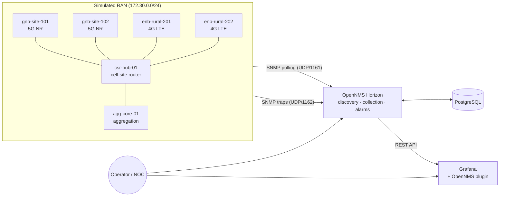

# RAN-Secure Analytics Platform

**Cloud-based, open-source monitoring and cyber-resilience framework for 4G/5G networks of small and regional operators.**

Author: Carlos Andres Andrade Marquez, Telecommunications Engineer

> **Status: Phase 1 – prototype / demo environment.** Everything in this repository runs against a
> *simulated* RAN. No customer data or production networks are involved.

---

## Why

Large mobile operators run vendor element managers, OSS suites and 24/7 NOCs. Small and regional
providers — WISPs, rural cooperatives, municipal networks and private LTE/5G operators — usually
cannot afford the licenses or the staff. They often learn about an outage from their subscribers.

RAN-Secure packages proven open-source components (OpenNMS Horizon, PostgreSQL, Grafana) with
RAN-specific know-how — which KPIs to collect, how to model cells, how to turn traps into actionable
alarms, how to harden the management plane — into a platform that one small operator can deploy
on-premises, or that many operators can share as an isolated, multi-tenant cloud service.

## What Phase 1 delivers

| Capability | Implementation in this repo |
|---|---|
| Simulated 4G/5G RAN | 2 gNodeB (5G NR), 2 eNodeB (4G LTE), 1 cell-site router, 1 aggregation router — each a separate container with its own IP and SNMP agent (`simulator/`) |
| RAN KPI model | `RAN-SECURE-SIM-MIB`: node CPU/temperature/UEs and per-cell PRB DL/UL, RRC setup success rate, active UEs, DL throughput, drop rate, availability (`mibs/`) |
| Inventory & discovery | OpenNMS requisition `RAN-Sim` with categories RAN / 5G-NR / 4G-LTE / Transport (`opennms/requisition/`) |
| Performance management | SNMP data collection for IF-MIB traffic and RAN KPIs, plus KPI graphs with engineering thresholds (`opennms/overlay/etc/`, `opennms/etc-first-start/`) |
| Fault management | Alarms for cell outage/restore (auto-clear) and node down (site power loss); standard IF-MIB link down/up traps for backhaul |
| Security monitoring | Critical alarm for repeated failed OAM logins (brute-force pattern) on a RAN element |
| Dashboards | Grafana with the OpenNMS Plugin for Grafana and pre-provisioned datasources (`grafana/`) |
| Repeatable demos | `scripts/scenario.sh` triggers each fault/security scenario and logs every run |

## Architecture



See [docs/ARCHITECTURE.md](docs/ARCHITECTURE.md) for the target multi-tenant cloud design.

## Quick start

Requirements: Docker Engine 24+ with Compose v2, ~4 GB RAM free, Linux/macOS/WSL2.

```bash
git clone <this-repo> ran-secure-analytics && cd ran-secure-analytics
cp .env.example .env          # edit every password
docker compose up -d --build  # first start of OpenNMS takes 3-5 minutes
./scripts/provision.sh        # uploads events, creates and imports the RAN-Sim requisition
```

| UI | URL | Login |
|---|---|---|
| OpenNMS Horizon | http://127.0.0.1:8980/opennms | `admin` / `admin` → **change it immediately**, then update `OPENNMS_API_PASSWORD` in `.env` |
| Grafana | http://127.0.0.1:3000 | `admin` / `GRAFANA_ADMIN_PASSWORD` |

After ~15 minutes (three 5-minute collection cycles) open **Reports → Resource Graphs → gnb-site-101**
to see the cell KPI graphs (PRB utilization, RRC success rate, throughput, drop rate...).

## Cloud deployment (public HTTPS)

Tested target: Ubuntu 24.04 LTS VM with 2 vCPU / 8 GB RAM / 160 GB SSD (e.g. AWS Lightsail, US East).

```bash
bash deploy/setup-ubuntu.sh                       # Docker, security updates, fail2ban, swap
cp .env.example .env && nano .env                 # strong passwords + ACME_EMAIL, ONMS_HOST, GRAFANA_HOST
docker compose -f docker-compose.yml -f deploy/docker-compose.cloud.yml up -d --build
./scripts/provision.sh
```

Caddy (`deploy/Caddyfile`) terminates TLS with automatic Let's Encrypt certificates and is the only
service listening on the Internet (80/443). OpenNMS and Grafana remain bound to `127.0.0.1`.
Open only TCP 22 (restricted to your IP), 80 and 443 in the provider firewall.

## Demo scenarios

```bash
./scripts/scenario.sh cell-outage     # NR-102-B out of service       -> Major alarm
./scripts/scenario.sh cell-restore    # NR-102-B back in service      -> alarm cleared automatically
./scripts/scenario.sh site-down       # rural site loses power        -> node down / outage
./scripts/scenario.sh site-up
./scripts/scenario.sh backhaul-flap   # cell-site router port flaps   -> link down / link up
./scripts/scenario.sh brute-force     # failed OAM logins on a gNodeB -> Critical security alarm
./scripts/scenario.sh restore-all
```

Each run is appended to `docs/demo-runs.log` with a UTC timestamp.

## Repository layout

```
docker-compose.yml          full stack (database, horizon, grafana, 6 simulated elements)
simulator/                  RAN element simulator (snmpsim) + data generator + trap sender
mibs/                       RAN-SECURE-SIM-MIB (SMIv2)
opennms/overlay/etc/        OpenNMS config overlay applied on every start: SNMP, KPI graphs
opennms/etc-first-start/    data collection config, applied on the first start only (Horizon 36 then keeps it in the database)
opennms/events/             event/alarm definitions for RAN-SECURE-SIM-MIB notifications
opennms/requisition/        inventory of the simulated network (generated)
grafana/provisioning/       Grafana plugin + datasources
scripts/                    provisioning and demo scenarios
docs/                       architecture, roadmap, evidence log
```

To change the simulated topology edit `DEVICES` in `simulator/generate_snmprec.py` and run
`python3 simulator/generate_snmprec.py` (regenerates the data files and the requisition), then
add the matching service in `docker-compose.yml`.

## Security notes

* All ports are bound to `127.0.0.1` by default. On a cloud VM publish the UIs only through a TLS
  reverse proxy, restrict access by source IP, and never expose PostgreSQL.
* SNMPv2c is used only inside the isolated simulation network. Real deployments must use SNMPv3
  (authPriv) and a dedicated management VRF/VLAN.
* Secrets live in `.env`, which is git-ignored.
* The private MIB uses enterprise number 32473, reserved by RFC 5612 for documentation, so it can
  never collide with a real vendor MIB.

## Roadmap

See [docs/ROADMAP.md](docs/ROADMAP.md). Summary: Phase 1 cloud demo (months 1–6) → pilots with U.S.
small/regional ISPs and WISPs (6–12) → AI/ML anomaly detection, multi-tenancy, NIST CSF alignment
(12–24) → SaaS commercialization (years 3–5).

## Built on

[OpenNMS Horizon](https://www.opennms.com/horizon/) · [PostgreSQL](https://www.postgresql.org/) ·
[Grafana](https://grafana.com/) · [OpenNMS Plugin for Grafana](https://github.com/OpenNMS-Plugins/grafana-plugin) ·
[snmpsim](https://github.com/lextudio/snmpsim) · [Net-SNMP](http://www.net-snmp.org/)
