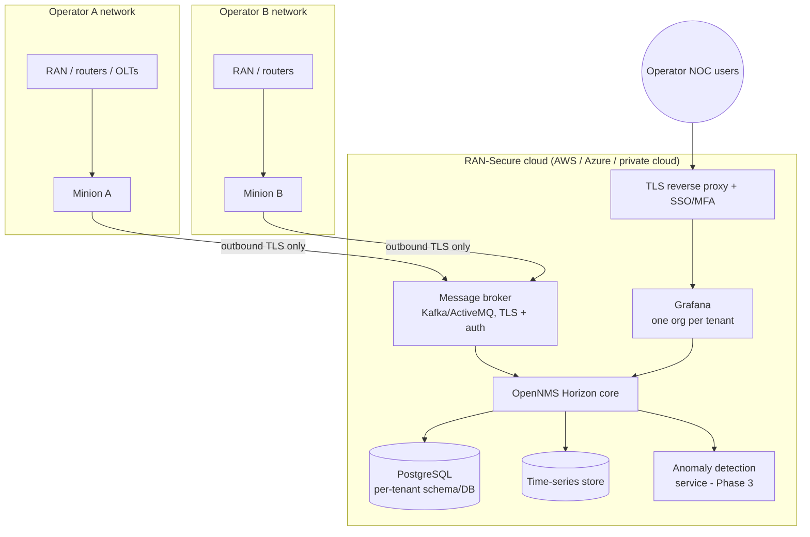

# RAN-Secure Analytics Platform – Architecture

## 1. Phase 1 (this repository): single-tenant demo

One Docker host (laptop or one cloud VM) runs the whole platform plus a simulated network:

| Component | Role | Notes |
|---|---|---|
| OpenNMS Horizon 36 | Provisioning, ICMP/SNMP polling, KPI collection, trap reception, event → alarm correlation, REST API | Config delivered as an overlay (`opennms/overlay`) so the stock image is never modified |
| PostgreSQL 16 | Inventory, events, alarms, outages | Never exposed outside the Docker network |
| Grafana 12 + OpenNMS plugin | Operator dashboards (performance + entities/alarms) | Datasources provisioned from `grafana/provisioning` |
| RAN element simulators | One container per element; own IP, SNMP agent and trap source | Data generated by `simulator/generate_snmprec.py` |

### Data model of a simulated RAN element

* **SNMPv2-MIB / IF-MIB / IP-MIB** – identity, interfaces with 32/64-bit traffic counters that grow at
  realistic backhaul/fronthaul rates.
* **RAN-SECURE-SIM-MIB** (`mibs/`) – the KPIs a RAN engineer watches every day:

| Object | Meaning | Typical engineering threshold |
|---|---|---|
| `ranCellPrbDlUtil` / `ranCellPrbUlUtil` | Radio resource (PRB) utilization | > 80 % sustained = congestion, capacity expansion |
| `ranCellRrcSuccRate` | RRC connection setup success rate | < 99 % = accessibility problem |
| `ranCellDropRate` | E-RAB / PDU-session drop rate | > 0.5 % = retainability problem |
| `ranCellActiveUEs`, `ranCellDlThroughput` | Load and user experience | trend / capacity planning |
| `ranCellAvailability` | Cell availability | < 99.9 % per day = SLA breach |
| `ranNodeCpuLoad`, `ranNodeTemperature` | Baseband health | overheating, overload |

KPI values follow slow sine waves with different periods per cell, so graphs look like real
busy-hour/off-peak traffic instead of flat lines.

### Fault and security events

| Trigger | OpenNMS result | Clears when |
|---|---|---|
| `ranCellOutage` trap | Major alarm per cell (reduction key = node + cell) | `ranCellRestored` trap (automatic clear) |
| Element unreachable (container stopped) | nodeDown / service outage | element answers again |
| IF-MIB `linkDown` on cell-site router | Standard SNMP link-down event (alarm per Horizon's built-in trap definitions; verify on first run) | `linkUp` |
| `ranSecurityAuthFailure` trap | Critical security alarm (repeated failed OAM logins) | operator acknowledges/clears after investigation |

## 2. Target architecture (Phases 2–4): multi-tenant cloud service

Design principles:

1. **No inbound access into customer networks.** An OpenNMS Minion inside each operator network polls
   locally and connects *outbound* to the cloud over TLS. Operators do not open firewall ports.
2. **Tenant isolation.** OpenNMS *locations* + per-tenant Minions separate collection; Grafana
   organizations and per-tenant API accounts separate visualization; data stores are partitioned
   per tenant. Operators that require full data sovereignty get a dedicated on-premises or private
   cloud instance from the same code base.
3. **Secure by default.** SNMPv3 authPriv, TLS everywhere, MFA for operators, least-privilege API
   accounts, audit logging, automated backups — mapped to NIST CSF 2.0 functions
   (Govern, Identify, Protect, Detect, Respond, Recover) in Phase 3.
4. **Open source, no license fees.** Every component is open source, which is what makes the service
   affordable for small providers.

## 3. Sizing assumptions (to be validated in Phase 2 pilots)

| Deployment | Elements | Indicative resources |
|---|---|---|
| Phase 1 demo | 6 simulated | 2 vCPU, 4–8 GB RAM, 40 GB disk |
| Small operator (dedicated) | up to ~500 | 4 vCPU, 16 GB RAM, 200 GB SSD |
| Shared multi-tenant core | several small operators | scale core + broker + time-series independently |

These figures are planning estimates, not measured results; Phase 2 will replace them with
measurements from pilot deployments.
