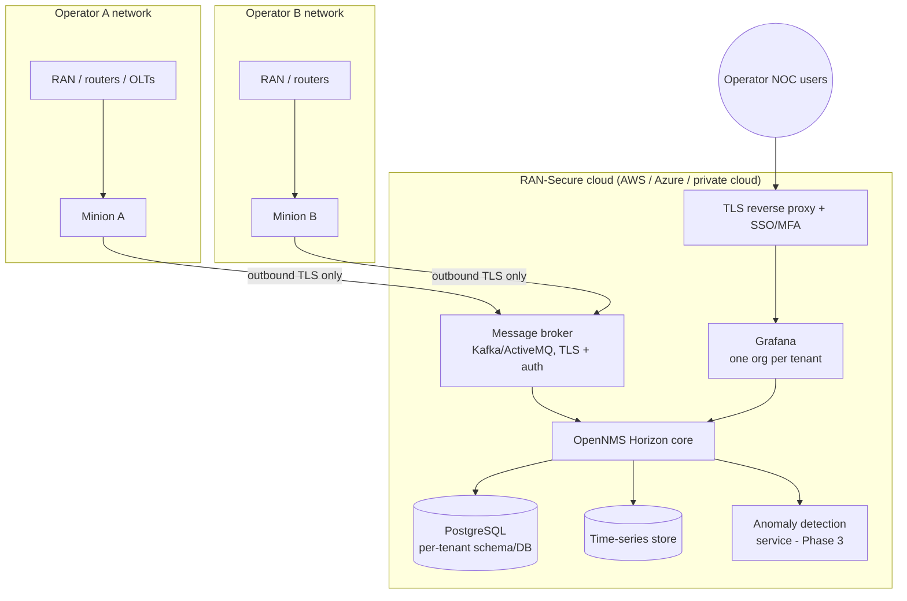

# RAN-Secure Analytics Platform – Architecture

## 1. Phase 1 (this repository): single-tenant demo

One Docker host (laptop or one cloud VM) runs the whole platform plus a simulated network:

| Component | Role | Notes |
|---|---|---|
| OpenNMS Horizon 36 | Provisioning, ICMP/SNMP polling, KPI collection, trap reception, event → alarm correlation, REST API | Config delivered as an overlay (`opennms/overlay`) so the stock image is never modified |
| PostgreSQL 16 | Inventory, events, alarms, outages | Never exposed outside the Docker network |
| Grafana 12 + OpenNMS plugin | Operator dashboards (performance + entities/alarms) | Datasources provisioned from `grafana/provisioning` |
| Network element simulators | One container per element (6 RAN + 10 transport/access); own IP, SNMP agent and trap source | Data generated by `simulator/generate_snmprec.py`; live values from the `rsdyn` snmpsim module |

### Data model of a simulated RAN element

* **SNMPv2-MIB / IF-MIB / IP-MIB** – identity, interfaces with 32/64-bit traffic counters that grow at
  realistic backhaul/fronthaul rates.
* **RAN-SECURE-SIM-MIB** (`mibs/`) – the KPIs a RAN engineer watches every day:

| Object | Meaning | Typical engineering threshold |
|---|---|---|
| `ranCellPrbDlUtil` / `ranCellPrbUlUtil` | Radio resource (PRB) utilization | > 80 % sustained = congestion, capacity expansion |
| `ranCellRrcSuccRate` | RRC connection setup success rate | < 99 % = accessibility problem |
| `ranCellDropRate` | E-RAB / PDU-session drop rate | > 0.5 % = retainability problem |
| `ranCellActiveUEs`, `ranCellDlThroughput` | Load and user experience | trend / capacity planning |
| `ranCellAvailability` | Cell availability | < 99.9 % per day = SLA breach |
| `ranNodeCpuLoad`, `ranNodeTemperature` | Baseband health | overheating, overload |

KPI values follow slow sine waves with different periods per cell, so graphs look like real
busy-hour/off-peak traffic instead of flat lines.

### Transport and access network

A RAN is only as available as the transport behind it, and most small operators also run fixed
broadband. The demo therefore models the whole path a subscriber's traffic takes:

```
RAN sites -> csr-hub-01 -> agg-core-01 -> pe-core-01 ==(DWDM lambda 1)== p-core-01 -> pe-core-02 -> Internet
                                              \________ diverse fiber route ________/        |
                                                                                        sw-agg-01
                                                                olt-town-01   olt-rural-02   sw-access-01
roadm-01 (POP A) --span 1, 62 km-- ila-01 --span 2, 71 km-- roadm-02 (POP B)
```

| Family | Elements | Standard MIBs | RAN-SECURE-NET-SIM-MIB (enterprise 32473.7) |
|---|---|---|---|
| IP/MPLS | `pe-core-01`, `p-core-01`, `pe-core-02` | IF-MIB, BGP4-MIB, LLDP-MIB | chassis health; LSP state, active path (primary/secondary), utilization, latency; BGP prefixes received |
| Ethernet | `sw-agg-01`, `sw-access-01` | IF-MIB (incl. broadcast/multicast/error counters), BRIDGE-MIB (STP topology changes), LLDP-MIB | chassis health; MAC table size |
| DWDM | `roadm-01`, `ila-01`, `roadm-02` | IF-MIB, LLDP-MIB | per-port Rx/Tx power, wavelengths per span, OSNR and pre-FEC BER per channel |
| GPON | `olt-town-01` (8 PONs), `olt-rural-02` (4 PONs) | IF-MIB, LLDP-MIB | per-PON ONUs registered/online, average and worst ONU receive power, OLT transmit power, downstream/upstream load |

Standard MIBs are used wherever a standard exists; the private module covers what operators
normally get from vendor-specific MIBs. Every element also exposes LLDP neighbors, so OpenNMS
(Enlinkd) builds the end-to-end topology map automatically.

Values come from `simulator/variation/rsdyn.py`, a small snmpsim variation module: daily-like
waves plus noise, and a state key on every value a scenario needs to change. `simulator/simctl.py`
edits that state inside a running container (`set`, `mul`, `add`, `ramp`), so a scenario changes
what OpenNMS polls — optical power drops to -40 dBm on a fiber cut, LSPs move to the secondary
path, ONU receive power drifts down over 20 minutes — and the matching notification is sent with
the names and values read from the element's own agent.

### Fault and security events

| Trigger | OpenNMS result | Clears when |
|---|---|---|
| `ranCellOutage` trap | Major alarm per cell (reduction key = node + cell) | `ranCellRestored` trap (automatic clear) |
| Element unreachable (container stopped) | nodeDown / service outage | element answers again |
| IF-MIB `linkDown` on cell-site router | Standard SNMP link-down event (alarm per Horizon's built-in trap definitions; verify on first run) | `linkUp` |
| `ranSecurityAuthFailure` trap | Critical security alarm (repeated failed OAM logins) | operator acknowledges/clears after investigation |
| `rsOptLos` (DWDM line or channel port) | Critical alarm per port; names the span or the circuit (e.g. a wholesale wavelength) | `rsOptLosCleared` |
| `rsLspPathProtected` | Warning per LSP: traffic protected on the secondary path, redundancy lost | `rsLspPathRestored` |
| `rsBgpPeerDown` | Major alarm per peer (e.g. upstream transit) | `rsBgpPeerUp` |
| `rsBroadcastStorm` | Major alarm per switch port (layer-2 loop at the customer site) | `rsBroadcastStormCleared` |
| `rsPonLos` | Critical alarm per PON: all ONUs lost without dying gasp, feeder fiber cut suspected | `rsPonLosCleared` |
| `rsPonDyingGaspBurst` | Major alarm per PON: many ONUs lost mains power, area power outage (no fiber crew needed) | `rsPonDyingGaspCleared` |
| `rsPonRxPowerLow` | Minor alarm per PON: worst ONU below -27 dBm, preventive maintenance before subscribers lose service | `rsPonRxPowerNormal` |

The `fiber-cut` scenario shows the value of monitoring all layers in one place: one physical
event produces 13 notifications from 6 elements in two layers (optical and IP/MPLS). The operator sees at a
glance that the root cause is span 2, that the IP core is protected (LSPs on the secondary path)
and which customer circuit is actually down.

## 2. Target architecture (Phases 2–4): multi-tenant cloud service



Design principles:

1. **No inbound access into customer networks.** An OpenNMS Minion inside each operator network polls
   locally and connects *outbound* to the cloud over TLS. Operators do not open firewall ports.
2. **Tenant isolation.** OpenNMS *locations* + per-tenant Minions separate collection; Grafana
   organizations and per-tenant API accounts separate visualization; data stores are partitioned
   per tenant. Operators that require full data sovereignty get a dedicated on-premises or private
   cloud instance from the same code base.
3. **Secure by default.** SNMPv3 authPriv, TLS everywhere, MFA for operators, least-privilege API
   accounts, audit logging, automated backups — mapped to NIST CSF 2.0 functions
   (Govern, Identify, Protect, Detect, Respond, Recover) in Phase 3.
4. **Open source, no license fees.** Every component is open source, which is what makes the service
   affordable for small providers.

## 3. Sizing assumptions (to be validated in Phase 2 pilots)

| Deployment | Elements | Indicative resources |
|---|---|---|
| Phase 1 demo | 16 simulated (6 RAN + 10 transport/access) | 2 vCPU, 8 GB RAM, 40 GB disk |
| Small operator (dedicated) | up to ~500 | 4 vCPU, 16 GB RAM, 200 GB SSD |
| Shared multi-tenant core | several small operators | scale core + broker + time-series independently |

These figures are planning estimates, not measured results; Phase 2 will replace them with
measurements from pilot deployments.
